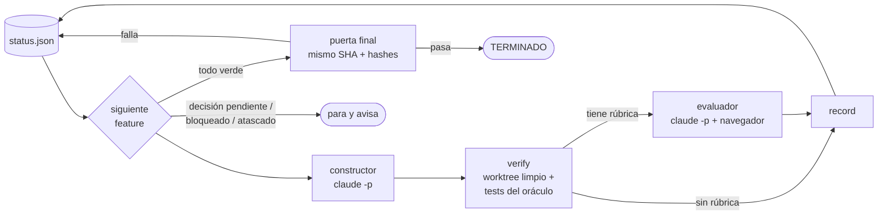

<div align="center">

# musthave

**Le das una lista de requisitos. Claude Code construye el proyecto entero, en bucle y sin supervisión, hasta que se cumplen todos.**
**Y no decide él cuándo ha terminado.**

[](core/bin)
[](https://claude.com/claude-code)
[](tests/harness.bats)
[](core/bin)
[](LECCIONES.md)
[](LICENSE)

[Guía](GUIA.md) · [Lecciones](LECCIONES.md) · [Ejemplo real](ejemplo/fast-reading/) · [Perfiles de stack](profiles/README.md)

</div>

---

## El problema

Si le dices a un agente "trabaja hasta que esté hecho", acabará diciendo que está hecho, lo esté o no. Es capaz de tocar los tests, de escribir código que detecta que lo están probando o de quedarse sin contexto y olvidar la mitad. Es el *reward hacking* de toda la vida.

## La solución

Un **bucle Ralph** (`while` + `claude -p` con sesiones limpias) en el que el agente solo construye y **otros deciden si ha terminado**:

| Defensa | Qué hace | Lo que impide |
|---|---|---|
| **Oráculo de root** | Los tests de aceptación se escriben *antes* que el código, se validan con mutantes y se congelan en una carpeta de root con hashes. La verificación usa los originales en un worktree limpio | Tocar los tests, falsificar el estado o decir "a mí me pasa" |
| **Evaluador separado** | Otro `claude -p`, sin Bash ni edición, que solo ve la app en un navegador y puntúa una rúbrica con salida JSON validada | Lo que los tests no ven: que la UI de verdad funcione |
| **Puerta final** | Con todo en verde: hashes, **todos** los tests sobre el **mismo commit** y el evaluador sobre todas las rúbricas | Regresiones y verdes conseguidos en commits distintos |
| **Detector de trampas** | Busca en el código `process.env.VITEST`, `navigator.webdriver`, `TODO`… | Código que se porta distinto cuando lo prueban |
| **Decisiones** | Si algo no cuadra, el constructor deja una pregunta en `decisions/` y el bucle para | Que se invente lo que no está especificado |



## Probado en un proyecto de verdad

[**fast-reading**](ejemplo/fast-reading/) es un lector RSVP de PDFs en el navegador (Vite + TypeScript + pdf.js) que extrae, tokeniza en español, temporiza y persiste un libro real de 220 páginas.

<div align="center">

| 31 / 31 | 260 | 1 h 15 min | < 8 % |
|:---:|:---:|:---:|:---:|
| MUST-HAVEs en verde | tests de aceptación | de bucle desatendido | del cupo semanal de un plan Max |

</div>

Por el camino, el constructor se paró él solo ante una dependencia mal declarada en vez de hacer trampa, y el evaluador pilló un fallo de persistencia que los tests e2e daban por bueno. Todo eso, con los números y lo que salió mal, está en [LECCIONES.md](LECCIONES.md).

## Arranque rápido

```sh
git clone https://github.com/JCouce/musthave.git && cd musthave
brew install jq coreutils bats-core
skill/install.sh                                  # instala la skill /musthave en Claude Code
core/bin/doctor.sh --smoke                        # comprueba máquina, login y claude -p
core/bin/new-project.sh mi-app ~/code/mi-app      # repo + staging con plantillas
```

Después: requisitos, contrato, tests y `feature_list.json` ([guía, fases 1-4](GUIA.md#fase-1--requisitos-must_havesmd)). Luego:

```sh
core/bin/check-deps.sh mi-app                     # dependencias sanas y orden previsto
sudo core/bin/freeze.sh mi-app                    # congela el oráculo (root + hashes)
caffeinate -i ~/.musthave/mi-app/oracle/bin/loop.sh 2>&1 | tee -a ~/.musthave/mi-app/state/loop.log
```

¿Prefieres que te guíen? Abre Claude Code y escribe **`/musthave`**: lee la guía, mira en qué fase está tu proyecto y te da el siguiente comando.

## Cómo es el proceso

| Fase | Tú | El harness |
|---|---|---|
| 0. Instalar | `doctor.sh --smoke` | comprueba herramientas, login de suscripción y `claude -p` |
| 1. Requisitos | `MUST_HAVES.md`: cada uno comprobable | plantilla + [prompt](guia/prompts/1-requisitos.md) |
| 2. Contrato | `CONTRACT.md`: rutas, firmas, `data-testid` | plantilla + [prompt](guia/prompts/2-contrato.md) |
| 3. Esqueleto | repo vacío que compila | `new-project.sh`, `init.sh` |
| 4. Oráculo | tests, rúbricas, `feature_list.json` | `try-tests.sh` (vacío / referencia / mutantes), `check-deps.sh` |
| 5. Congelar | `sudo freeze.sh` | root + hashes + estado inicial |
| 6. Prueba | `MAX_ITER=1 loop.sh` | una vuelta para ver el coste |
| 7. Bucle | lánzalo y vete | elige, construye, verifica, evalúa y reintenta |
| 8. Paradas | contesta `decisions/`, `unblock.sh` | exit codes claros: 0 · 3 · 4 · 5 · 6 |
| 9. Cerrar | pruébala tú | puerta final + `report.sh` (tokens y coste) |

Detalle completo, con "listo cuando" en cada fase: **[GUIA.md](GUIA.md)**.

## Agnóstico al stack

El núcleo es bash 3.2 + jq y no sabe nada de tu lenguaje. Lo que depende del stack (instalar, compilar, pasar tests y servir la app) va en un **perfil** de 3 ficheros con un contrato mínimo: devolver un JSON `{"MH-07": {"passed": 12, "failed": 0, …}}`. Qué cuenta como "ok" lo decide siempre el núcleo.

| Perfil | Stack | Estado |
|---|---|---|
| [`node-vitest-playwright`](profiles/node-vitest-playwright/) | Node + TS · Vitest · Playwright · Vite | probado (fast-reading y demo) |
| *el tuyo* | lo que uses | [cómo escribir uno](profiles/README.md) |

## Qué hay dentro

```
core/bin/        el núcleo: loop, verify, final-gate, freeze, check-deps, try-tests,
                 new-project, doctor, unblock, report, constructor y evaluador
core/prompts/    prompts del constructor y del evaluador, esquema del veredicto y MCP del navegador
profiles/        adaptadores de stack y su contrato
templates/       plantillas de repo (MUST_HAVES, CONTRACT, AGENT…) y de staging
guia/prompts/    prompts para las fases de diseño
ejemplo/         fast-reading completo: requisitos, contrato, tests, rúbricas, log y consumo
skill/           la skill /musthave
tests/           19 tests del núcleo con un claude falso: ningún escenario tramposo acaba en exit 0
```

## Requisitos

- macOS o Linux con `bash`, `git`, `jq`, `rsync`, `shasum`, `curl` y `lsof`. Recomendado `gtimeout`/`timeout` (coreutils).
- [Claude Code](https://claude.com/claude-code) con **login de suscripción**. El bucle quita `ANTHROPIC_API_KEY` para no gastar API.
- `sudo` solo para congelar el oráculo.

## Inspiración

[Ralph Wiggum as a software engineer](https://ghuntley.com/ralph/) (Geoffrey Huntley) · [Effective harnesses for long-running agents](https://www.anthropic.com/engineering/effective-harnesses-for-long-running-agents) y [Building effective agents](https://www.anthropic.com/engineering/building-effective-agents) (Anthropic) · [Spec Kit](https://github.com/github/spec-kit) (GitHub) · el trabajo de METR sobre *reward hacking*. Por qué no `/loop`, `/goal` ni Stop hooks: [LECCIONES.md](LECCIONES.md#6-lo-que-se-descartó-como-motor-del-bucle-y-por-qué).
